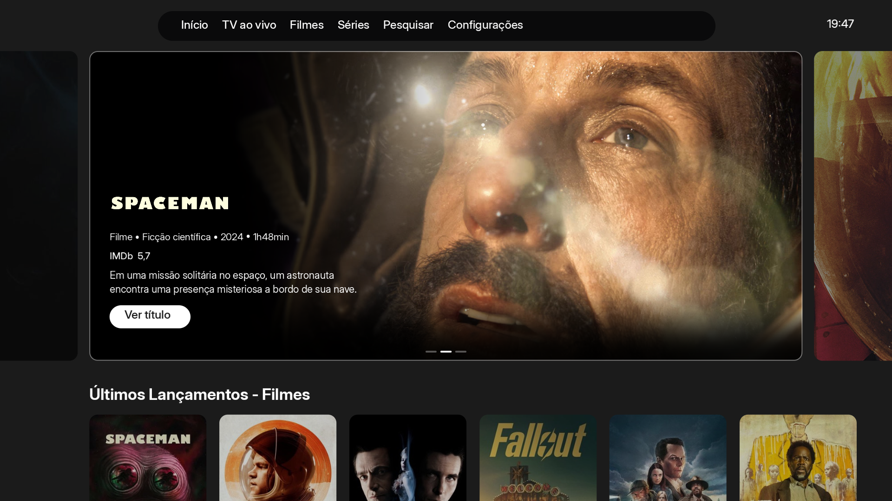

# Home opcional Globoplay

Referencia: imagem web enviada pelo usuario em 28/10/2026. Pedido explicito:
adicionar uma opcao chamada Globoplay, preservando a Home e os layouts existentes.

## Comportamento

- Novo valor 3, acrescentado ao enum e a lista de selecao. Moderna=0,
  Padrao=1 e Dinamica=2 preservados. Nenhuma migracao ou troca automatica.
- A escolha usa a chave local existente `homeLayoutLocal` e fica fora da
  sincronizacao com a conta. A mesma tela oferece a volta aos outros layouts.
- Caminho: Ajustes → Tela inicial → Layout da home → Globoplay.
- Painel central com 80% da largura, proporcao aproximada de 2.30:1,
  cantos arredondados e uma previa estatica de cada vizinho disponivel.
- Texto e logo dentro do painel. Navegacao e conjunto de titulos usam as
  mesmas funcoes do carrossel existente; nenhum catalogo ou fonte extra.
- Somente um player de video. COVER e janela atomica acompanham a abertura,
  sem o zoom adicional da Home Moderna. O canvas fecha o video fora do painel.
- Degrade local esquerda/base e cantos, composto com alfa premultiplicado:
  a foto desaparece quando o video entra, inclusive nas rampas.
- Menu no topo somente nesta opcao, sem alterar a preferencia salva do menu.
  Ao descer, o Hero sai com a mola vertical comum e os cartazes ancoram abaixo
  do cabecalho. Nao ha uma segunda animacao independente de rolagem.
- Vizinhos protegidos por spoiler ficam neutros, evitando expor still ou
  alternar varias artes no cache de blur em cada quadro.

## Previa

[Fileiras](fileiras.png) · [Transicao](transicao.png)

O painel/carrossel das imagens executa `desenhaHeroGloboplay`, `globoPainel`
e `globoVizinho` extraidos do codigo real, com `gfx.c` completo. Conteudo,
texto, barra superior e fileiras do driver sao fixtures demonstrativas; nao
e captura da execucao completa do app, de emulador Android ou da TCL.

## Validacao e limites

- `streammax-globoplay-home.py`: shader real, cantos opacos, limite do video,
  substituicao progressiva da foto e escalas de 85% a 150%.
- Bloco real de D-pad, `heroPasso`/intencao e mola vertical: limites,
  toques seguidos, menu, primeira fileira vazia e assentamento a 30/60/120 Hz
  simulados. Abertura publica o indice correto para a tela de titulo.
- `test_globoplay_settings.c` inclui `ajustes.c` completo: quatro escolhas,
  indices anteriores/default, retorno, valores invalidos, menu e escopo local.
  Sanitizadores habilitados. Nao simula a leitura completa do arquivo de
  preferencias nem a sincronizacao/autenticacao de uma conta real.
- `streammax-trailer-open.sh`: `trailer.c` completo com Moderna e Globoplay,
  abertura fria/quente em COVER, metadata tardia e destinos cartao/detalhe.
- Regressao da Moderna: a previa produzida com os mesmos assets e funcoes
  permaneceu identica, byte a byte, a imagem aprovada da 1.0.25. Isso nao e
  uma comparacao de todas as telas de todos os layouts.
- Renderizador anterior, rolagem horizontal, prioridades dos trailers,
  retirada dos frames e verificacoes do pacote continuam no processo de build.

Nao houve medicao de FPS nem teste fisico na TCL. Os testes de entrada e
catalogo usam dependencias controladas, nao emulam o compositor MediaCodec.
Os controles no aparelho e a aparencia final precisam de confirmacao na TV.

Branch `feat/streammax-globoplay-home`; preparando 1.0.26, codigo 20033.
O registro de publicacao e integridade sera acrescentado apos o APK verificado.
