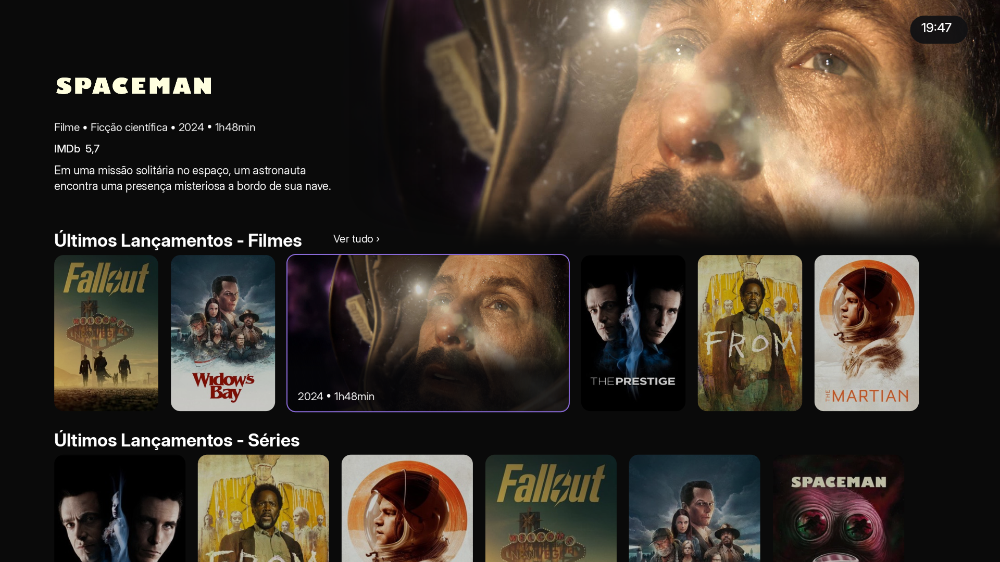

# Hero com mais altura e menos corte do trailer

Pedido de 28/10/2026: testar 15% a mais de altura util, revisar o zoom e enviar
uma previa, preservando o degrade aprovado na TCL depois da 1.0.24.

## Resultado implementado

- Apenas Home Moderna de Android TV, com Hero ligado: topo dos cartazes passa
  de 426 para 489,9 unidades de layout (+15%). Em uma captura 1280x720 na
  escala padrao, equivale a 284 -> 326,6 px. Cabecalho continua com 48 unidades.
- A janela do player usa o espaco visivel mais a reserva de foco do Hero:
  513,9 unidades, em vez de centralizar o filme numa caixa de 670 cuja parte
  inferior ja estava escondida pelos cartazes.
- A mascara continua com 670: fecha tambem a foto abaixo do video, evitando
  que o backdrop reapareca logo abaixo da janela menor.
- O zoom fixo de 35% passa a uma margem de 2%, com ampliacao adicional somente
  quando uma fonte aproximadamente 16:9 precisa preencher a caixa mesmo com
  barras embutidas de cinema ate 2.40:1. Isso e uma heuristica de proporcao;
  nao existe deteccao das barras pelos pixels, nem garantia para barras atipicas.
- Na escala padrao, o exemplo 16:9 passa de 35% para 2% de overscan. Nao se
  deve generalizar esse percentual para todas as proporcoes/escalas.
- Shader, curva lateral/inferior e crossfade de 480 ms preservados. A base do
  degrade acompanha a primeira fileira mais baixa. Nenhum decoder, textura de
  producao ou passada extra de shader foi adicionado.

## Imagens e limites da previa



[Comparativo antes/depois](comparativo.png) · [Antes](antes.png) ·
[Medidas](medidas.json)

As imagens sao **previas tecnicas**, nao fotografias da TCL nem capturas da
execucao completa da Home. O programa compila `gfx.c` completo e extrai do
codigo real as funcoes de altura, caixa, enquadramento e posicao da copia do
Hero. Usa as mesmas texturas locais do projeto como quadro estatico e cartazes;
textos e fileiras sao fixtures demonstrativas. A composicao entre o plano do
video e o canvas e calculada com source-over premultiplicado, sem MediaCodec.
Assim e possivel comparar o enquadramento e o degrade com a mesma imagem.

Baseline imutavel da 1.0.24:
`da499ecbb9693ec46979f2dc5ce5939850181090`.

## Verificacoes

- `streammax-trailer-edges.py`: renderizador GLES completo, escala de texto de
  85% a 150%, foco no Hero/fileira, transparencia e continuidade das bordas,
  direita preenchida e ausencia de reaparecimento da foto abaixo do player.
  Agora usa `homeShelfTop`, cabecalho e empurrao reais, em vez das fixtures
  antigas de 378/48/144. Hero desligado, celular e outro layout mantem o topo.
- `streammax-hero-trailer.sh`: cover sem distorcao, fontes de cinema/16:9/
  quadradas/verticais, metadata ausente, barras embutidas ate 2.40, ganho de
  conteudo no terco inferior; prioridade de audio e legendas preservada.
- `streammax-trailer-open.sh`, ASan/UBSan: `trailer.c` inteiro com a nova altura;
  abertura fria/quente, janela COVER antes da Surface, metadata tardia,
  destinos de cartao/detalhe e tratamento de falha.
- `streammax-home-scroll.py`, ASan/UBSan: foco/retorno/repouso horizontal em
  host/Android, com/sem toque. Nao e medicao de FPS nem teste integrado da
  navegacao vertical com controle fisico.
- Home visual, retirada dos frames inclusive com preferencias antigas,
  atualizador e sintaxe de `home.c` com/sem NV_TOUCH_UI.
- O gerador de previa compara as medidas reais das duas revisoes e verifica
  aumento de altura de 15%, reducao do zoom no exemplo e maior extensao da
  fonte visivel antes do inicio do degrade.

Comandos (dependencias de desenvolvimento SDL/GLES/EGL e JDK17):

```sh
python3 legacy-source/tests/streammax-trailer-edges.py
SM_SANITIZERS=1 bash legacy-source/tests/streammax-trailer-open.sh
bash legacy-source/tests/streammax-hero-trailer.sh
SM_SANITIZERS=1 python3 legacy-source/tests/streammax-home-scroll.py
python3 legacy-source/tests/streammax-hero-preview.py --output output/hero-preview
```

O gerador de previa tambem usa Pillow e os assets locais do projeto. Os
parametros SM_CFLAGS/SM_GL_LIBS permitem os headers/bibliotecas do ambiente.

## Distribuicao

Mudanca salva na branch `feat/streammax-hero-height`, para o pedido de testes
e previa. **Nenhum novo APK ou OTA foi publicado nesta etapa**; a ultima versao
distribuida continua 1.0.24. Faltam compilacao Android da nova revisao,
confirmacao visual na TCL e medicao fisica de desempenho.
